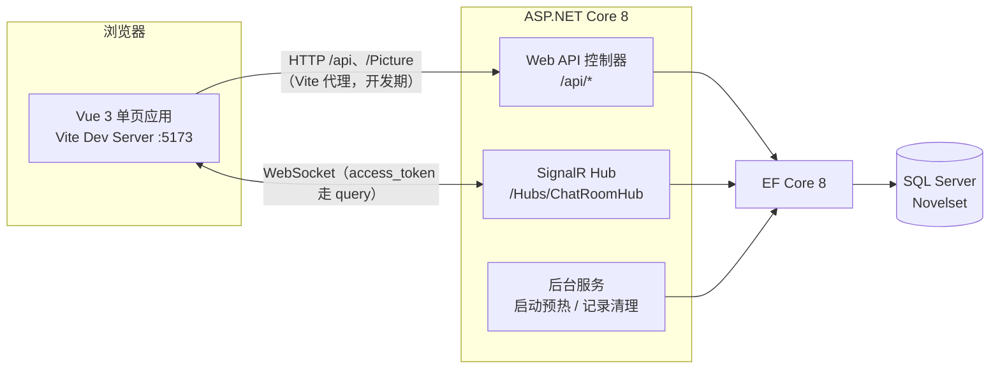

# 冰柏叶小说库

一个前后端分离的在线小说阅读平台：浏览与搜索小说、分页目录与章节阅读、收藏、评论点赞、阅读历史、上传并管理自己的作品，以及基于 SignalR 的实时站内公告与私信。

> 说明：前端页面由 AI 完成，后端服务与接口为本人独立完成。

---

## 目录

- [功能特性](#功能特性)
- [技术栈](#技术栈)
- [系统架构](#系统架构)
- [目录结构](#目录结构)
- [快速开始](#快速开始)
- [配置说明](#配置说明)
- [接口一览](#接口一览)
- [SignalR 实时通道](#signalr-实时通道)
- [数据库设计要点](#数据库设计要点)

---

## 功能特性

**账号与鉴权**

- 注册 / 登录，基于 ASP.NET Core Identity + JWT Bearer
- 密码强度校验（Identity 策略）、登录失败 5 次锁定 5 分钟
- 角色声明写入 Token，便于后续做后台权限

**小说**

- 列表：分类、关键词（书名 / 作者）、连载状态筛选；排序支持「最近更新 / 点击最多 / 收藏最多」
- 详情：简介、标签、章节总数、收藏状态、上次阅读位置
- 目录：服务端分页（100 章 / 页），跳转任意章节
- 阅读器：上一章 / 下一章、目录抽屉、字号与行距、背景主题

**互动**

- 一级评论 + 点赞切换，游客可评论（未登录时记录为空用户）
- 收藏 / 取消收藏（切换式接口，返回最新收藏数）

**阅读历史**

- 打开章节时由服务端自动写入，按「年 月」分组展示
- 支持单条删除，后台清理服务按时间自动清理旧记录

**我的小说**

- 新建小说（书名、分类、封面、简介），编辑已有小说（分类 / 状态 / 封面 / 简介）
- 单章添加（章节序号、标题、正文、是否锁定）
- 封面上传（jpg / jpeg / png / gif，≤ 2MB）

**实时能力**

- 私聊：一对一发消息，未读数在重连时补发
- 站内公告：首页顶部滚动「最新一条系统广播」，公告页列表展示最近 100 条站内公告
- 断线自动重连（指数退避 1s → 3s → 8s → 15s → 30s）

---

## 技术栈

| 层 | 技术 |
| --- | --- |
| 后端框架 | ASP.NET Core 8（`net8.0`） |
| 数据访问 | Entity Framework Core 8.0.34 + SQL Server |
| 认证授权 | ASP.NET Core Identity + JWT Bearer |
| 实时通信 | SignalR（`/Hubs/ChatRoomHub`） |
| 接口文档 | Swagger / Swashbuckle 6.5 |
| 定时任务 | `IHostedService`（数据库预热、阅读记录清理） |
| 前端框架 | Vue 3.5 + TypeScript + Vite 8 |
| UI 组件 | Element Plus 2.14 + `@element-plus/icons-vue` |
| 状态与路由 | Pinia + Vue Router 4 |
| 请求层 | Axios（统一信封拆包 + Token 注入 + 401 处理） |
| 实时客户端 | `@microsoft/signalr` 11 |

---

## 系统架构



**认证流程**：登录 → 后端签发 JWT → 前端存入 `localStorage` → Axios 拦截器自动附带 `Authorization: Bearer <token>`；SignalR 握手时通过 `access_token` 查询参数携带 Token，由 `JwtBearerEvents.OnMessageReceived` 取出并校验。

---

## 目录结构

```
NovelProject/
├─ NovelProject.sln
├─ .gitignore
├─ README.md
├─ .github/                         # 预留：CI 工作流
│
├─ NovelProject/                    # 后端
│  ├─ Controllers/                  # Auth / Novels / Chapters / Categories /
│  │                                # Comments / Favorites / ReadingRecords /
│  │                                # Files / Notification
│  ├─ DTO/                          # 请求与响应 DTO、ApiResponse 统一信封
│  ├─ Migrations/                   # EF Core 迁移
│  ├─ Background/                   # 数据库预热、阅读记录清理
│  ├─ Picture/                      # 运行时封面上传目录
│  ├─ ChatRoomHub.cs                # SignalR Hub
│  ├─ MyDbContext.cs                # DbContext
│  ├─ JwtService.cs                 # Token 签发
│  ├─ *Config.cs                    # 各实体的 Fluent API 配置
│  ├─ appsettings.json
│  └─ Program.cs
│
└─ NovelWeb/                        # 前端
   ├─ public/images/                # 主题图、叶子 Logo、统一封面
   ├─ src/
   │  ├─ api/                       # 按模块封装的接口方法
   │  ├─ components/                # AppLayout / NovelCard / AuthDialog / NoticeMarquee ...
   │  ├─ router/                    # 路由与登录守卫
   │  ├─ stores/                    # Pinia（登录态）
   │  ├─ types/                     # 与后端 DTO 对应的 TS 类型
   │  ├─ utils/                     # axios 封装、SignalR 客户端、格式化
   │  └─ views/                     # 首页 / 列表 / 详情 / 阅读器 / 收藏 /
   │                                # 历史 / 分类 / 公告 / 我的小说
   ├─ vite.config.ts                # 别名 + 代理
   └─ package.json
```

---

## 快速开始

### 环境要求

| 依赖 | 版本 |
| --- | --- |
| .NET SDK | 8.0 及以上 |
| SQL Server | 2019 及以上（本地默认实例即可） |
| Node.js | 18 及以上 |

### 1. 后端

```bash
cd NovelProject/NovelProject
```

**① 配置签名密钥**（不写进代码，用 .NET User Secrets）

```bash
dotnet user-secrets set "JWT:SecKey" "<至少 32 字符的随机串>"
```

生成一串随机密钥：

```powershell
[Convert]::ToBase64String((1..32 | ForEach-Object { Get-Random -Maximum 256 }))
```

**② 创建数据库并执行迁移**

首次使用需要安装 EF Core 工具（只需一次）：

```bash
dotnet tool install --global dotnet-ef
```

```bash
dotnet ef database update
```

也可以在 Visual Studio 的程序包管理器控制台执行 `Update-Database`。

连接串默认指向本机默认实例并使用 Windows 认证，EF Core 会自动创建 `Novelset` 数据库：

```
Server=.;Database=Novelset;Trusted_Connection=True;TrustServerCertificate=True
```

**③ 启动**

```bash
dotnet run
```

接口文档：<https://localhost:7112/swagger>

> Swagger 里点 **Authorize** 填入 Token 后，才能调试带 `[Authorize]` 的接口。

### 2. 前端

```bash
cd NovelWeb
npm install
npm run dev
```

访问 <http://localhost:5173>。

前端通过 Vite 代理把 `/api`、`/Picture`、`/Hubs` 转发到 `https://localhost:7112`，因此**后端必须先启动**，否则列表页会出现 `ECONNREFUSED`。

生产构建：

```bash
npm run build     # 产物在 dist/
```

### 3. 演示数据

仓库自带 4 本演示书籍与若干章节、封面图（位于 `NovelProject/Picture/`）。注册一个账号即可体验收藏、评论、阅读历史与上传功能。

---

## 配置说明

| 配置项 | 本地开发 | 生产部署 |
| --- | --- | --- |
| `ConnectionStrings:Default` | `appsettings.json`（Windows 认证，无密码） | 环境变量 `ConnectionStrings__Default` |
| `JWT:SecKey` | `dotnet user-secrets`（不进仓库） | 环境变量 `JWT__SecKey` |
| `JWT:ExpireSeconds` | `appsettings.json`，默认 86400 | 同上或环境变量 |
| `CorsSettings:AllowOrigins` | `appsettings.json`，默认 `http://localhost:5173` | 改成实际站点域名 |

配置优先级：`appsettings.json` → `appsettings.{Environment}.json` → User Secrets（仅 Development）→ 环境变量 → 命令行参数，后者覆盖前者。

> 环境中必须存在 `JWT:SecKey`，否则 JWT 签发会失败。部署到 Linux 容器时不能用 Windows 认证，请改用 SQL 登录名并为其授予最小权限（`db_datareader` / `db_datawriter` / `db_ddladmin`）。

---

## 接口一览

所有接口统一返回信封：

```json
{ "code": 200, "message": "操作成功", "data": {} }
```

分页接口的 `data` 包含 `total`（总条数）与 `data`（当前页数组），另附页码与页大小字段；字段名在不同控制器间不完全统一（`pagesize` / `pageSize`），前端按 `.total` 与 `.data` 消费。

| 模块 | 方法与路径 | 鉴权 | 说明 |
| --- | --- | --- | --- |
| 认证 | `POST /api/Auth/register` | 匿名 | 注册 |
| | `POST /api/Auth/login` | 匿名 | 登录，返回 Token / 昵称 / 用户 ID |
| 分类 | `GET /api/Categories` | 匿名 | 分类列表（可按启用状态、排序号） |
| | `GET /api/Categories/{id}` | 匿名 | 分类详情 |
| | `POST /api/Categories` | 需要 | 新增分类 |
| | `DELETE /api/Categories/{id}` | 需要 | 删除分类 |
| 小说 | `GET /api/Novels` | 匿名 | 列表：分类 / 关键词 / 完结 / 排序 / 分页 |
| | `GET /api/Novels/{id}` | 匿名 | 详情 |
| | `GET /api/Novels/mine` | 需要 | 我创建的小说（分页） |
| | `POST /api/Novels` | 需要 | 新建小说 |
| | `PUT /api/Novels/{id}` | 需要 | 编辑小说（仅作者本人） |
| | `DELETE /api/Novels/{id}` | 需要 | 删除小说 |
| | `POST /api/Novels/{id}/import-txt` | 需要 | 上传 TXT，按「第 N 章」正则切章入库 |
| 章节 | `GET /api/Chapters` | 匿名 | 目录（分页，可倒序） |
| | `GET /api/Chapters/{id}` | 匿名 | 章节正文与上下章 |
| | `POST /api/Chapters` | 需要 | 新增章节 |
| | `DELETE /api/Chapters/{id}` | 需要 | 删除章节 |
| 评论 | `GET /api/Comments` | 匿名 | 评论列表（按小说或章节） |
| | `POST /api/Comments` | 匿名 | 发表评论（未登录视为游客） |
| | `POST /api/Comments/{id}` | 需要 | 点赞 / 取消点赞 |
| 收藏 | `POST /api/Favorites` | 需要 | 切换收藏，返回是否已收藏与收藏数 |
| | `GET /api/Favorites` | 需要 | 我的收藏（分页） |
| | `GET /api/Favorites/check?novelId=` | 需要 | 是否已收藏该书 |
| | `POST /api/Favorites/remove` | 需要 | 移出收藏 |
| 阅读记录 | `GET /api/ReadingRecords` | 需要 | 阅读历史（分页） |
| | `GET /api/ReadingRecords/{novelId}/last` | 需要 | 该书上次读到的章节 |
| | `DELETE /api/ReadingRecords?recordId=` | 需要 | 删除单条阅读记录（只能删自己的） |
| 文件 | `POST /api/Files/upload-cover` | 需要 | 上传封面（form-data 字段名 `file`） |
| 通知 | `POST /api/Notification/sitewidebroadcast` | 需要 | 推送全站系统广播 |
| | `POST /api/Notification/notice` | 需要 | 推送站内公告（公屏消息通道） |

---

## SignalR 实时通道

服务端 Hub：`/Hubs/ChatRoomHub`

| 方向 | 事件 | 载荷 |
| --- | --- | --- |
| 服务端 → 客户端 | `ReceiveSystemMessage` | `{ title, content, time }`（首页滚动条） |
| 服务端 → 客户端 | `ReceivePublicMessage` | 字符串（站务公告页列表） |
| 服务端 → 客户端 | `ReceivePrivateMessage` | `{ fromUserId, fromUserName, message, messageId }` |
| 服务端 → 客户端 | `ReceiveUnreadMessage` | 未读消息列表（连接建立 / 重连时补发） |
| 客户端 → 服务端 | `SendPrivateMessage(toUserId, message)` | 发送私聊 |
| 客户端 → 服务端 | `MarkMessageAsRead(messageId)` | 标记已读（仅收件人） |
| 服务端 → 客户端 | `SendPrivateMessageSuccess` / `SendPrivateMessageFailed` / `SendMessageError` | 发送结果与错误 |

握手鉴权：默认 WebSocket 无法自定义请求头，因此前端把 Token 拼在 URL 上（`?access_token=...`），后端在 `JwtBearerEvents.OnMessageReceived` 中判断路径是否属于 Hub，是则从查询串取 Token 校验。

---

## 数据库设计要点

- **表名前缀统一** `T_`，通过 `IEntityTypeConfiguration` + `ApplyConfigurationsFromAssembly` 装配
- **软删除**：书籍、章节、评论、收藏、阅读记录均带 `IsDeleted`，配合全局查询过滤器（`HasQueryFilter`）自动隐藏
- **原子自增**：点击量用 `UPDATE T_Novels SET ClickCount = ClickCount + 1 WHERE NovelId = @id`，避免「先读后写」的并发丢更新
- **唯一索引**：`(UserId, NovelId)` 保证同一用户对同一本书只有一条收藏 / 阅读记录
- **时间字段**统一使用 UTC（`DateTime.UtcNow`）
- 全表 `AsNoTracking()` 用于只读查询，列表接口使用投影 DTO 而不是实体

---

## 免责声明

本项目仅用于学习与技术展示，书籍、封面等内容均为演示数据，请勿用于商业用途。
